# BÁO CÁO BÀI TẬP

## THÔNG TIN SINH VIÊN
- **Họ và tên: Đặng Cao Thành Đạt**
- **Mã số sinh viên: 24810320215** 
- **Lớp: D19QTANM1** 
- **Tên môn học: Lập Trình.Net** 
- **Tên bài tập: Bài tập 2: Quản lý mượn trả thiết bị tại phòng thực hành** 

---

## KẾT QUẢ THỰC HÀNH

## KẾT QUẢ THỰC HÀNH

### 1. Ảnh màn hình Giao diện chính
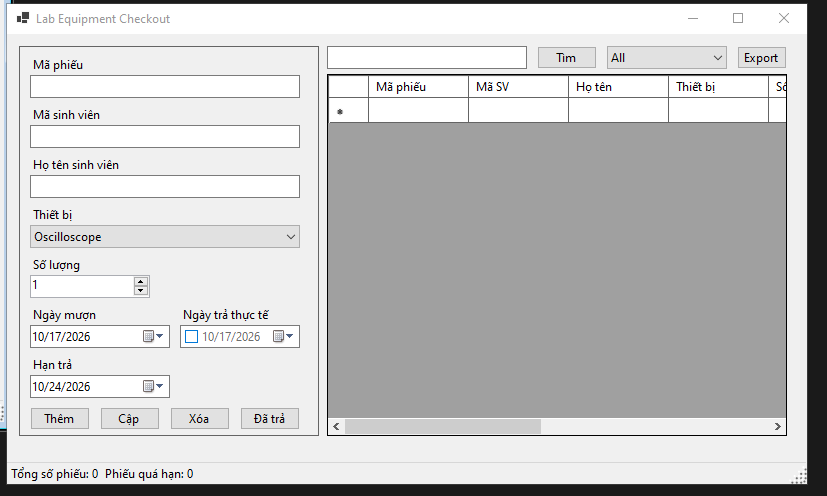

### 2. Form co giãn
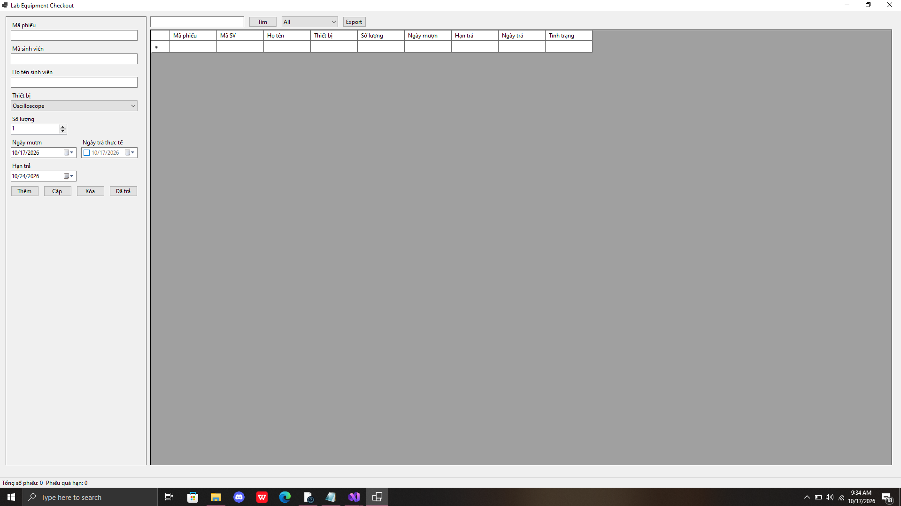

### 3. Thêm phiếu thành công
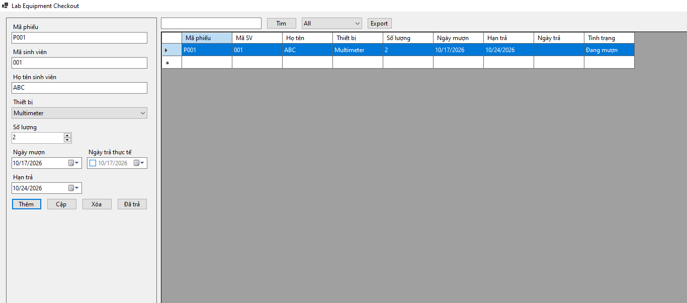

### 4. Cập nhật phiếu
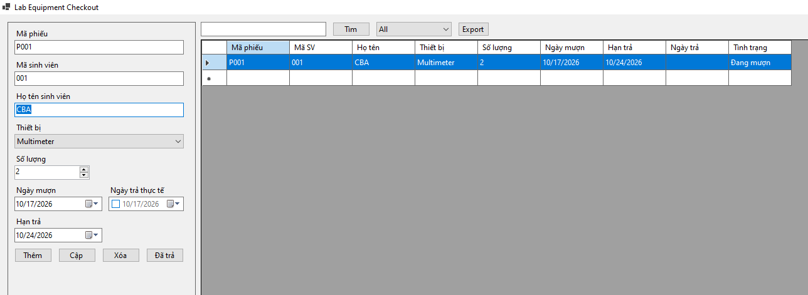

### 5. Xóa có xác nhận
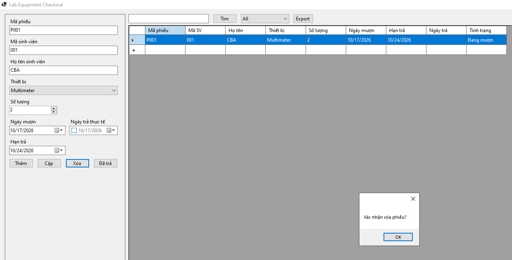
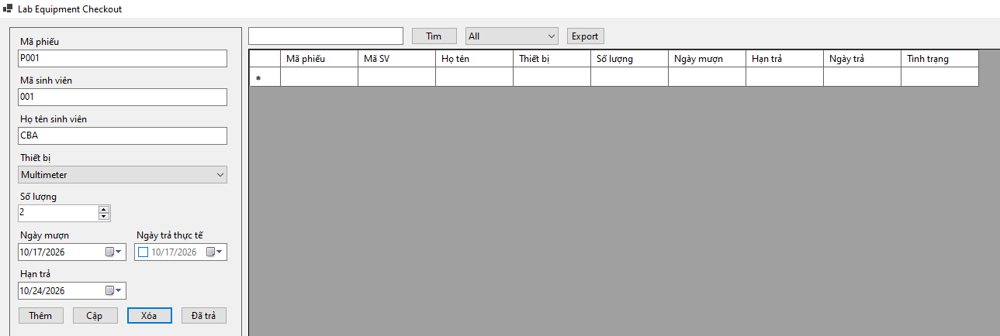

### 6. Tìm kiếm
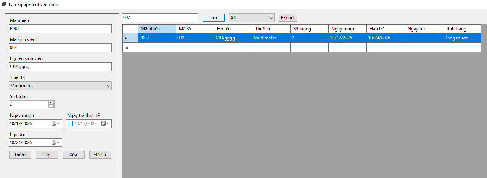

### 7. Lọc theo trạng thái

### 8. Đánh dấu đã trả
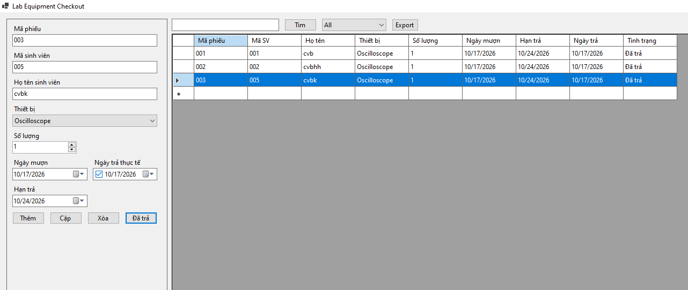

### 9. ErrorProvider khi Hạn trả < Ngày mượn
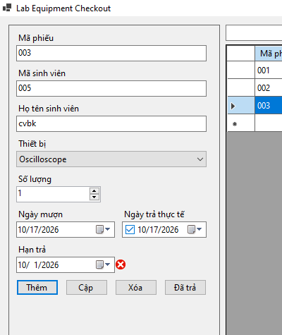

### 10. Các lỗi validate khác
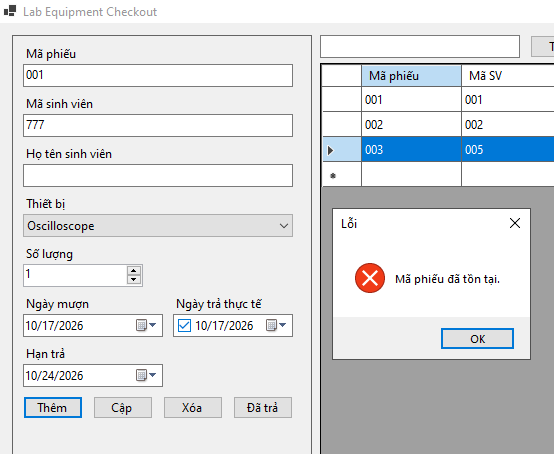

### 11. Xuất CSV
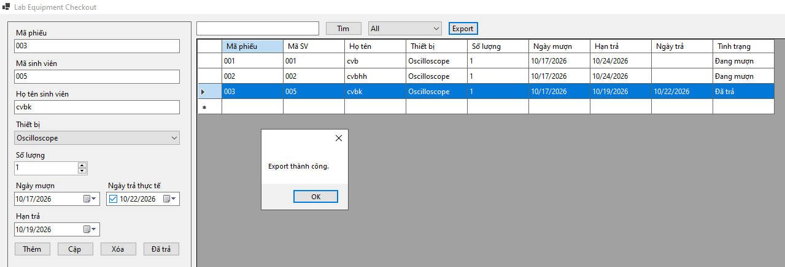
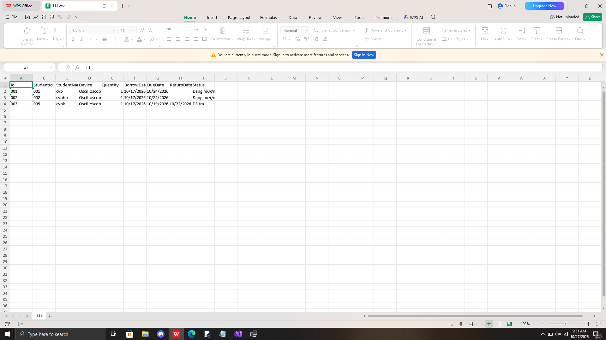